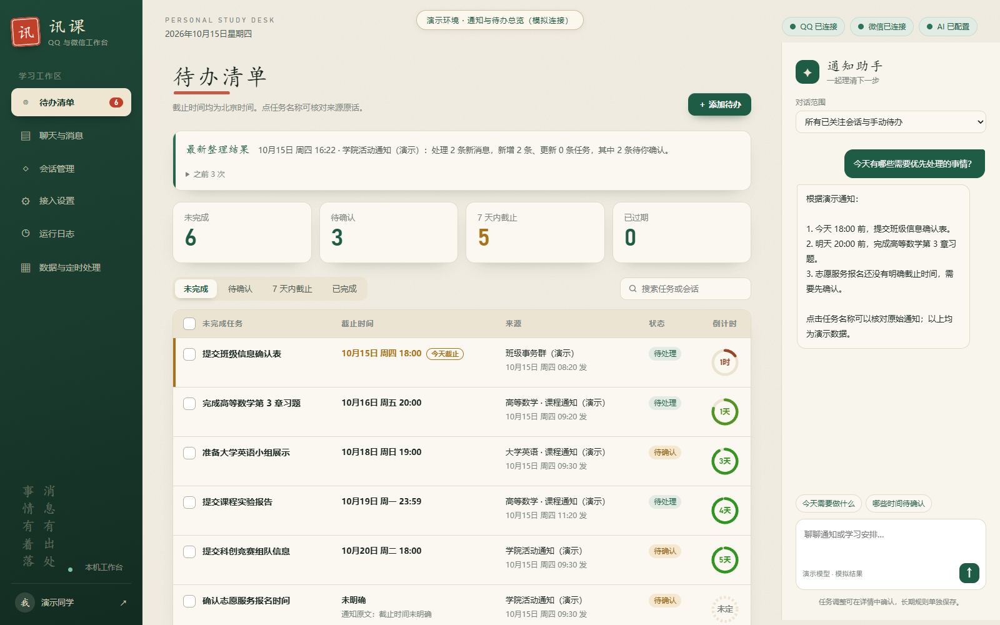
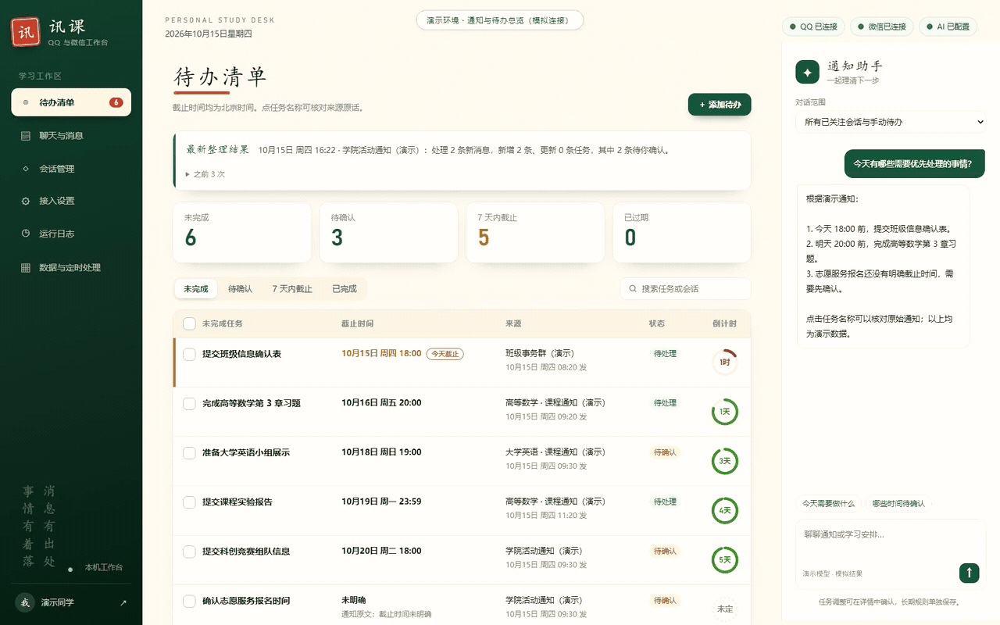
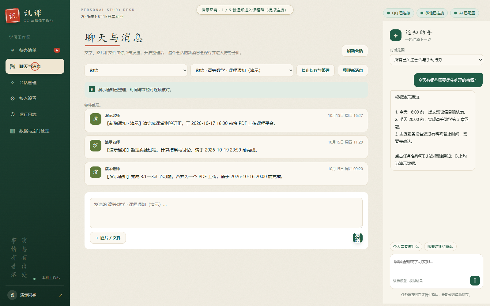
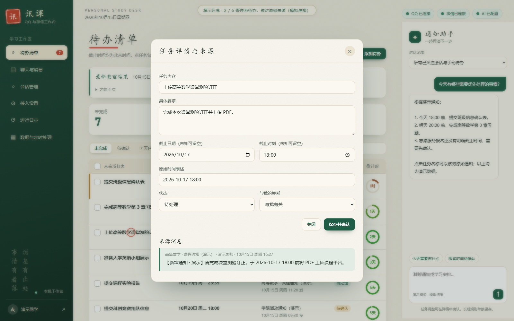
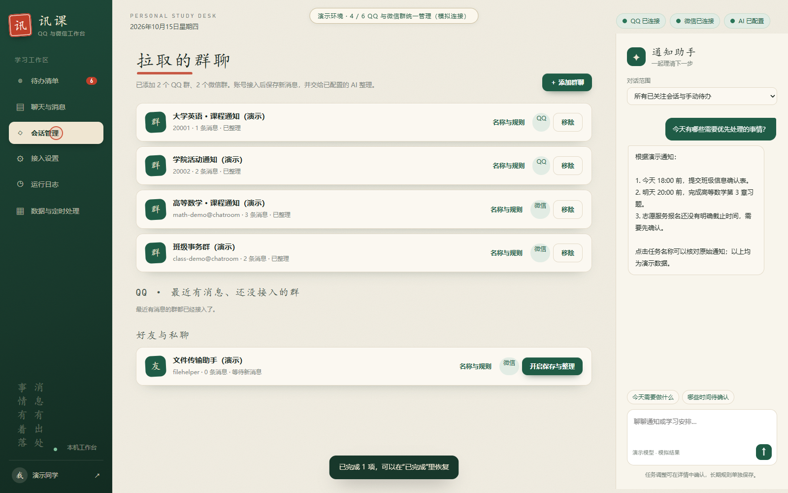
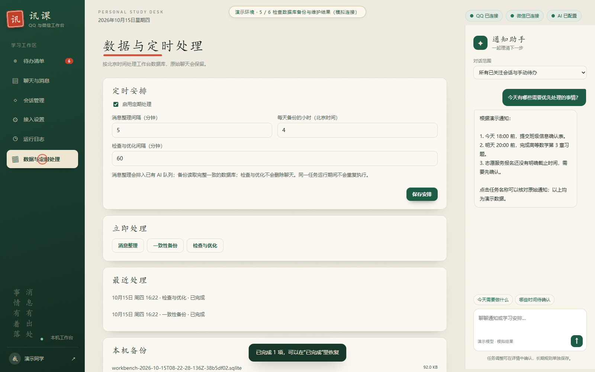
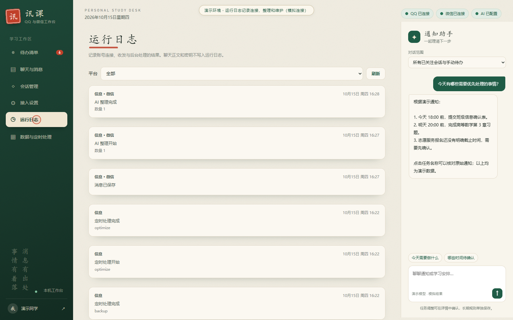
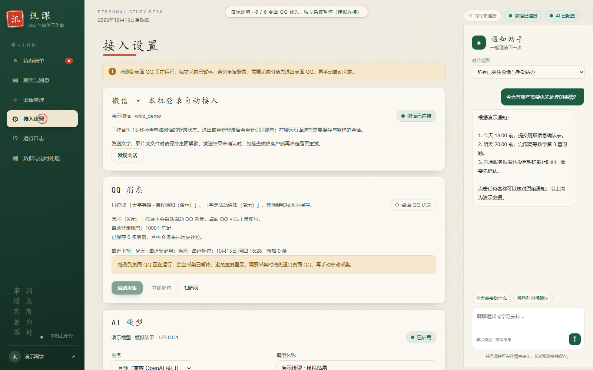

# qq&wechat bench

QQ 与微信通知、消息和待办的本地工作台。程序名称：讯课 · QQ 与微信工作台。

[下载 v0.5.2](https://github.com/forkseek/qq-wechat-bench/releases/tag/v0.5.2) · [首次运行与发布包说明](PACKAGING.md) · [兼容性验收](docs/最终兼容性与稳定性验收-2026-10-15.md)

## 运行预览

以下为程序在隔离演示环境中的实际界面截图与操作录制。账号、通知、连接状态和模型结果均为模拟数据；画面中持续标注演示环境。桌面 QQ 正在运行时，独立采集仍按原设计暂停。

**工作台总览：**查看未完成任务、待确认事项、截止时间、通知来源与通知助手。



**约 15 秒操作演示：**新通知进入 → 整理待办 → 核对原文 → 人工确认完成 → 查看群聊、维护日志和 QQ 暂停状态。



<details>
<summary>查看另外 6 张运行截图</summary>

**聊天与消息：**按平台和会话查看通知，已关注会话的新消息进入整理队列。



**任务详情与来源：**截止日期、时刻和原始时间表述一起展示，原通知保留在详情中供核对。



**QQ 与微信群统一管理：**区分平台、查看消息数量与整理状态，选择保存和整理的会话。



**数据库与定时处理：**查看整理间隔、备份时间、检查与优化结果。



**运行日志：**查看连接、消息整理、备份与维护的结果。



**桌面 QQ 优先：**展示独立采集暂停的提示和禁用的启动操作，微信继续保持连接。



</details>

媒体尺寸、演示范围和文件信息见 [截图与 GIF 说明](docs/media/README.md)。

## 讯课 · QQ 与微信工作台

在本机统一查看 QQ 与微信聊天，手动发送文字、图片和文件；关注学校通知会话后自动保存原话，并用已配置的 AI 提取带截止时间、可追溯来源的待办。当前版本 `0.5.2`。

需要 Node.js 24 或更高版本及 `npm.cmd ci`。本机已安装独立的 Python 3.12.10 和微信接入组件；重新准备微信组件可运行 `setup-wechat.ps1`，固定源码和依赖见 `THIRD_PARTY_NOTICES.md`、`requirements-wechat.txt`。

本机兼容性与稳定性验收见 [2026-10-15 验收报告](docs/最终兼容性与稳定性验收-2026-10-15.md)。`0.5.2` 修复微信读取超时恢复、会话故障隔离、重复启动误改状态、部分发送误报、日志写入失败和页面异步响应竞态；Windows 检查命令同时验证系统 PowerShell 5.1 的脚本编码。

## 程序结构与 JSON 配置

默认参数统一放在 [`config/workbench.json`](config/workbench.json)：工作台与 QQ 接口端口、轮询间隔、附件限制、定时处理默认安排和模型预设。配置会校验字段、类型与范围；默认监听固定为本机地址。修改后先关闭工作台，再重新打开。

- 端口优先级：进程环境变量 `PORT` → `.env` 的 `PORT` → JSON 默认端口。Node、PowerShell、Python 都通过同一个解析入口读取，支持 `.env` 中带引号的值。
- 页面保存的模型设置仍在 `data/model.json`；模型预设只填写表单默认值。文件损坏时停用 AI 并提示重新保存，不切换到环境变量中的其他服务。
- 页面保存的定时安排仍在 SQLite 中，优先于 JSON 的默认安排。消息、来源、待办和发送结果继续使用 SQLite 事务保存。
- 密钥保存在原有私有配置中。默认 JSON 只包含可共享参数，浏览器只获得经过筛选的界面设置。
- JSON 配置采用完整写入后替换的方式保存；保存失败会保留旧文件。关闭工作台时先完成正在处理的请求，再停止后台组件并释放数据库。

入口 `server.mjs` 负责组装服务；`lib/http.mjs` 统一处理来源、会话、签名和请求大小，`lib/api.mjs` 分发业务接口。完整检查、模块图与验证记录见 [`docs/结构检查-2026-10-15.md`](docs/结构检查-2026-10-15.md)。

## 双平台聊天

- 打开工作台并正常登录电脑微信，后台每 15 秒识别当前登录账号与会话，无需另扫工作台二维码。当前实机验证微信 `4.1.13.65`，SDK 为 wechatauto-replica `1.2.6.1`。
- 在“聊天与消息”按 QQ、微信或全部筛选，选择会话查看正文。未开启保存与整理的会话只临时读取；会话信息会保存，聊天正文不会进入工作台数据库或 AI。
- 在“拉取的群聊”点击“添加群聊”，可切换 **QQ 群 / 微信群**并搜索。微信群列表来自当前登录电脑微信的最近会话（最多 200 个会话）；找不到群时，先在电脑微信打开该群，再点“刷新列表”。点击添加后，读取该群最近的本机消息并开始持续保存、整理；移除会停止保存新消息，已保存的消息和待办保留。微信与 QQ 群分别标注平台，同名群按账号和原生编号区分。
- 点击“开启保存与整理”，该会话会持续保存新消息并进入既有 AI 队列。微信消息按账号、会话及数据库分片隔离，QQ 群沿用原来的跨采集账号合并规则。
- 输入文字、选择最多 5 个图片或文件，再点击发送。单个附件上限 50 MB。发送由你触发，工作台记录结果；未确认时先核查客户端，后台不会自动重发。
- 微信发送复用本机 GUI，要求桌面解锁和客户端可访问。按真实会话编号绑定账号，再验证显示名不重复及当前聊天标题；未能确认目标时停止发送。
- 微信图片、文件可通过消息旁的按钮读取本机已缓存的内容，自己发送的文件也可使用经过消息证据核对的发送副本；原件未下载时需要先在微信客户端打开。文件/链接/卡片并非每条都包含可读取文件。媒体读取与常规接入分开运行。其他媒体仍显示类型提示，AI 当前只分析文字。
- **QQ 使用 NapCat Shell 独立采集，并优先保留桌面 QQ。**检测到普通桌面 QQ 进程时，自动停止本工作台的独立采集、取消常驻开关；桌面退出后，需要手动开启采集。此判断按进程进行，不读取桌面账号，因此也会保护正在扫码的桌面 QQ。普通桌面 QQ 直接接入补丁仍未安装；桌面使用期间，工作台的 QQ 新消息采集和发送暂停。

## 日志与定时处理

在“运行日志”查看账号连接、收发、AI 整理和后台任务结果，按平台筛选。日志放在 `data/logs/workbench-日期.jsonl`，界面读取最近 14 个日志文件；正文、模型密钥和微信数据库密钥不写入运行日志。

“数据与定时处理”可以调整计划或立即执行。默认按北京时间：

| 任务 | 默认安排 | 作用 |
| --- | --- | --- |
| 消息整理 | 每 5 分钟 | 将已关注会话的待处理消息加入已有 AI 队列；完成情况看 AI 批次记录 |
| 一致性备份 | 每天 04:00 | 使用 SQLite 在线备份，包含 WAL 中的数据；完成后才显示为 `.sqlite` 备份 |
| 检查与优化 | 每 60 分钟 | `quick_check`、`PRAGMA optimize` 和被动 WAL checkpoint |

同一任务不会重叠运行，计划和结果保存在本机数据库。维护仅处理工作台的 `workbench.sqlite`，保留原始聊天；微信源数据库保持只读。备份位于 `data/backups/`。

## 日常使用

| 双击 | 作用 |
| --- | --- |
| `打开工作台.cmd` | 启动工作台，打开 `http://127.0.0.1:4318`。采集开关开启且没有桌面 QQ 时，恢复 QQ 采集 |
| `打开QQ采集.cmd` | 通过统一接口开启 QQ 采集并打开扫码页；桌面 QQ 正在运行时说明冲突，不重复启动 |
| `停止QQ采集.cmd` | 关闭 QQ 采集，只停止本工作台启动的 QQ 进程 |
| `关闭工作台.cmd` | 停止工作台服务（QQ 采集的开关状态会保留） |
| `open_workbench.py` | Python 版启动器：没在运行就在后台启动工作台，然后打开页面。加 `--qq` 会同时开启 QQ 采集，加 `--no-browser` 不打开浏览器，加 `--stop` 停止工作台；用 `pythonw` 运行不弹命令行窗口 |

在“接入设置”页面也可以启动、停止 QQ 采集，立即补拉历史消息，或开关**开机自启**。开机自启会在 Windows「启动」文件夹放一个快捷方式“讯课工作台”，登录 Windows 后在后台启动工作台；关掉开关或删掉这个快捷方式就取消了。

**自动采集链路**：开机自启 → 工作台启动 → 采集开关开启且桌面 QQ 没有运行时自动登录 → 实时接收与补拉 → AI 整理 → 待办清单。首次登录或 QQ 验证时需要扫码；检测到桌面 QQ 会暂停这条采集链路，保护桌面登录。

**QQ 采集常驻的工作方式**

- 开启后，工作台每 15 秒检查 QQ 消息桥（NapCat）及桌面 QQ。采集启动器或 QQ 子进程还在时不会重复启动；确认没有桌面 QQ 或现有采集进程后才自动拉起。连续失败时，重试间隔为 3、5、10 分钟；无法读取进程状态时暂停启动。
- 第一次需要扫码。登录成功后，工作台会记住这个账号，之后用本机的登录记录免扫码登录。在设置页点“忘记”后，下次启动又会要求扫码。
- QQ 刚登录或恢复在线时，以及在线期间每 30 分钟，工作台会从最新的消息往前补拉，直到接上已经保存的消息为止（最多 100 条）。重复的消息会自动去重；消息流按发送时间排序。
- 同一账号在桌面 QQ 与独立采集中可能提示“账号已登录，无法重复登录”。现在优先使用桌面 QQ；需要恢复采集时先退出桌面 QQ，再在设置中点击“启动采集”。停止接口按可执行文件、父子关系和创建时间核对进程，通过系统进程管理确认终止；失败会报告错误，保留桌面 QQ 和本地数据。修复记录见 [QQ 登录修复](docs/QQ登录修复-2026-10-15.md)。
- 要拉取哪些群，在“会话管理”页面添加或移除。添加时可以从当前 QQ 账号加入的群里选；QQ 没登录时也可以直接填群号，最多 20 个。新添加的群会立即补拉一次。移除后不再拉取和整理，已保存的消息和任务会保留，之后可以恢复。设置保存在 `data/capture.json`。登录后自动发现好友与群的会话信息，只有选定会话的正文保存并进入 AI。

页面地址可以直接带视图打开，例如消息流：`http://127.0.0.1:4318/?view=messages`。

## 功能

- **待办清单**：最上方是“最新整理结果”（AI 每整理完一批记一条），下面是**未完成任务**表格，列出未完成任务、截止时间、来源和状态。
  - 未完成任务指状态为待处理、且不是明确属于别人的事项。属于别人的只在表格下方注明有几条。
  - 截止时间一律按北京时间显示，格式如“10月16日 周四 17:00”，不是今年时会加上年份。每条都会注明依据：通知原文写明的、按消息发送日推算的（附原文）、你自己填写的，或“未明确”（附原文里“尽快”之类的说法）。推算出来的时间不当作确定的截止时间。
  - 排序：已过期（标红，并显示过期天数）→ 今天截止 → 按日期往后 → 没有截止时间的。
  - 也可以按“待确认”“7 天内截止”筛选，或查看“已完成”；支持搜索、手动新增、修改、完成和恢复。点任务名称可以查看来源原话和修改记录。
- **聊天与消息**：合并两个平台的会话入口，微信查看最近 80 条消息；支持用户手动发送文字、图片、文件，及查看本机缓存的微信图片和文件。图片里的文字 AI 当前看不到。
- **群聊管理**：添加或移除要拉取的群；每个群可以设置名称和整理规则。
- **AI 整理**（需配置模型）：新消息保存后自动按批次交给模型，提取任务名称、完成状态、截止时间（附依据），以及原文中有的类型、要求和负责人。结果必须引用真实的来源消息；不明确的时间和负责人进入“待确认”；AI 只能建议“已完成”，要你确认后才会改；分析期间你手动做的修改不会被覆盖。整理失败时消息会保留，10 分钟后自动重试。
- **通知助手**（需配置模型）：右侧对话栏，结合通知和待办回答问题。未配置模型时隐藏。

## 配置 AI 模型

在“接入设置”页面填写即可，保存后立即生效，不用重启：

1. 服务选 DeepSeek，会自动填好服务地址 `https://api.deepseek.com` 和模型名 `deepseek-flash`。其他兼容 OpenAI 接口的服务请选“其他”，自己填写。
2. 粘贴在服务商控制台创建的 API Key，先点“测试连接”，成功后再点“保存”。
3. 保存后，已关注会话里还没整理的消息会自动开始整理。

设置保存在本机 `data/model.json`（包括 Key），这个目录不会被 Git 提交。在线服务的地址必须是 HTTPS；本地模型可以用 `http://127.0.0.1:11434/v1`，不需要 Key。在线模型分析时，会收到所关注会话的文字、相关任务和整理规则。如何选择在线 API 或本地模型，见 [docs/模型选择说明.md](docs/模型选择说明.md)。

页面上没有保存过设置时，工作台会读取 `.env` 中的 `MODEL_ENABLED`、`MODEL_BASE_URL`、`MODEL_NAME`、`MODEL_API_KEY`（参考 `.env.example`）。

模型需要兼容 `/chat/completions` 接口并支持 JSON 输出。每批最多处理 25 条新消息，并附带 20 条前文；单条消息超过 1800 字时截断。模型超时、返回格式错误或引用了不存在的来源时，这一批结果不保存，消息保留，10 分钟后自动重试。

## 接入其他 OneBot 11 消息桥

`打开QQ采集.cmd` 会自动配置 NapCat，一般不需要手动设置。改用其他兼容 OneBot 11 的工具时：

1. 添加 HTTP 客户端上报，地址填 `http://127.0.0.1:4318/onebot/events`，消息格式选 `array`。
2. token 填 `data/connection.json` 中的 `secret`。工具会用它对请求正文做 HMAC-SHA1 签名，放在 `X-Signature` 头中。
3. 删除 `data/capture.json` 后，所有会话都会出现在“群聊管理”中，由你决定关注哪些。

工作台只监听 `127.0.0.1`，事件上报返回空的 204 响应。消息发送通过独立接口，仅由用户手动触发；未增加群管理操作。

## 开发

```powershell
npm.cmd start        # 前台运行，Ctrl+C 停止
npm.cmd test         # 行为测试（使用临时数据库、模拟事件和模拟模型）
npm.cmd run check    # 语法检查
```

`server.mjs` 是 HTTP 服务。`lib/` 包括原有消息标准化、数据库、AI、采集看护，以及双平台发送协调（messaging）、微信私有 IPC（wechat-bridge）、事件日志（event-log）和定时维护（maintenance）。`scripts/wechat-worker.py` 适配已审查的微信 SDK。`public/` 是界面，`start.ps1` 和 `start-qq.ps1` 是 `.cmd` 调用的启动脚本。

所有数据都在 `data/` 中：数据库 `workbench.sqlite`、连接密钥 `connection.json`、NapCat 运行包 `napcat/`。这个目录已被 Git 忽略，不要公开分享。

参考：[OneBot HTTP POST](https://github.com/botuniverse/onebot-11/blob/master/communication/http-post.md) · [NapCat 配置](https://doc.napneko.icu/config/basic) · [NapCat v4.18.37 发布页](https://github.com/NapNeko/NapCatQQ/releases/tag/v4.18.37)
