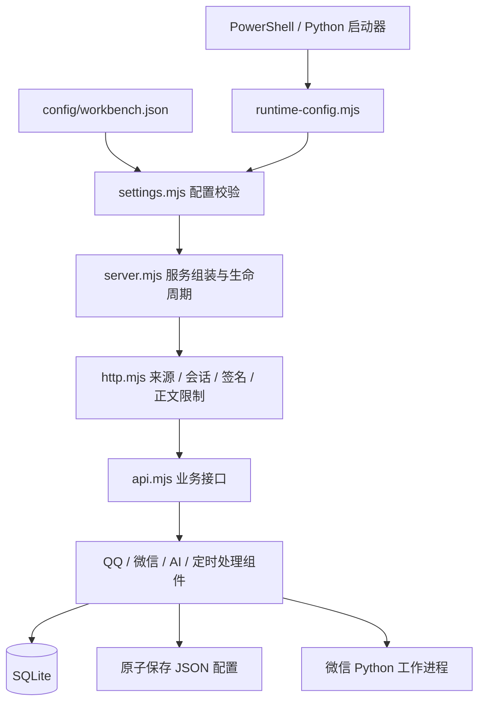

# 程序结构检查与调整

日期：2026-10-15。源码版本：0.5.0。

检查覆盖程序入口、HTTP 接口、业务组件、Node/Python/PowerShell 启动流程、JSON 配置、SQLite 读写、后台任务和浏览器界面。第三方组件继续使用已有固定版本，本次核对其适配器、进程和缓存边界。

## 发现与处理

| 问题 | 影响 | 本次处理 |
| --- | --- | --- |
| 端口、轮询、附件限制与默认任务安排分散在多个文件 | 修改一处后，不同启动器或前后端可能不一致 | 集中到 `config/workbench.json`，统一字段及范围校验；启动器共用 `runtime-config.mjs` |
| 服务入口混合认证、接口、配置与组件组装 | 维护接口时容易连带修改安全与启动逻辑 | 分离 `http.mjs`、`api.mjs`；入口缩为 173 行，版本直接来自 `package.json` |
| JSON 配置直接覆盖保存 | 写入失败可能破坏上一份有效配置 | 同目录临时文件写入、同步后替换；失败清理临时文件并保留原文件 |
| 已保存模型配置损坏后静默读取环境变量 | 可能意外选用另一模型服务 | AI 停用并显示恢复提示，保存后的文件继续优先；支持 UTF-8 BOM |
| 微信旧进程退出事件作用于全部等待请求 | 旧进程延迟退出可能拒绝新连接的请求 | 请求及响应绑定所属进程；关闭后拒绝重开，缓存目录跟随 `dataDir` |
| 消息组件停止期间，已开始的检查可能继续启动微信 | 工作台关闭后仍有后台残留的时序风险 | 统一停止标志，等待正在发送的操作，关闭连接并结束检查；重复关闭共用结果 |
| 保存定时设置会隐式启动未开启的调度器 | 只做配置检查时也可能创建后台任务 | 分离配置保存、启动和停止；保存失败不改变内存配置 |
| 直接结束服务进程，关闭顺序分散 | 正在处理的请求及发送结果可能来不及完成 | 增加受会话和来源保护的安全关闭接口；启动器验证目标 PID，优先完成请求后退出 |
| SQLite 初始化或服务组装失败时缺少统一释放 | Windows 文件句柄可能遗留 | 初始化失败及正常退出都释放数据库；应用关闭支持重复调用 |

## 结构

| 位置 | 职责 |
| --- | --- |
| `config/workbench.json` | 无密钥的默认参数 |
| `lib/settings.mjs` | JSON 校验、端口解析、界面可见配置筛选 |
| `lib/json-file.mjs` | BOM 兼容读取、原子保存 |
| `server.mjs` | 组装组件、消息接收流程、采集范围变更、启动与退出 |
| `lib/http.mjs` | 本机 Host/Origin、会话、OneBot 签名、静态资源白名单与正文大小限制 |
| `lib/api.mjs` | 调用各业务组件处理接口 |
| `lib/store.mjs` | SQLite 数据、事务、原有兼容迁移 |
| `lib/qq-bridge.mjs`、`lib/supervisor.mjs` | QQ 采集接口与桌面登录保护 |
| `lib/wechat-bridge.mjs`、`scripts/wechat-worker.py` | 微信 JSON IPC、进程与缓存隔离 |
| `lib/messaging.mjs` | 查看、保存、人工发送、附件与结果核验 |
| `lib/model.mjs`、`lib/maintenance.mjs` | AI 整理与定时处理 |
| `public/` | 使用服务返回的预设、限制和轮询参数 |

静态核对的 23 个后端及脚本 JavaScript 模块：未发现缺失的相对导入或循环依赖。模块摘要及源码哈希保存在本机 `data/verification/structure-check-20261015.json`。

## JSON 的使用规则

| 字段 | 用途 / 默认值 |
| --- | --- |
| `schemaVersion` | 配置格式版本，目前为 `1` |
| `server` | 监听本机，默认端口 `4318`，JSON 请求正文上限 1 MB |
| `qq` | 接口端口 `6099`，15 秒检查，重试间隔 3/5/10 分钟，30 分钟补拉 |
| `messaging` | 15 秒轮询、120 秒请求等待、每个附件最多 50 MB、每次最多 5 个附件 |
| `maintenance` | 每 5 分钟整理、04:00 备份、每 60 分钟检查优化，北京时间 |
| `ui` | 主界面 5 秒刷新，QQ 登录页 4 秒检查 |
| `modelPresets` | 接入表单中的模型服务预设，包含名称与地址 |

修改已有字段即可，需保留完整 JSON 结构。未知字段、非本机监听、端口冲突、错误类型和不合理间隔会被拒绝。工作台端口优先级为环境变量、`.env`、JSON；修改端口前先关闭正在运行的工作台。修改 QQ 接口端口后，采集下一次启动时会同步对应本机接口配置并保留原令牌。

模型密钥仍使用 `data/model.json` 或 `.env`。浏览器获取的 `settings` 仅含界面预设、刷新与附件参数。模型文件损坏时，AI 停用且提示重新保存；消息与待办可继续查看。采集范围损坏时拒绝启动，避免使用意外范围。

既有用户定时安排保存在 SQLite，优先于默认 JSON；更改默认安排不会覆盖用户已经保存的计划。QQ 常驻开关也保留原来的独立状态，程序默认参数不会开启采集。

## 架构决策

采用单个 Node 服务与独立微信工作进程，按职责拆分内部模块。当前是个人本机工作台，这种结构便于单机启动、事务保存和检查，后续增加渠道时可继续扩展适配器。

JSON 管理声明式参数；SQLite 管理消息、来源、任务、发送结果和用户计划。SQLite 保留事务、去重与关联能力。此次调整使用 Node 内置能力，沿用既有依赖。

前端仍按当前六个页面组织；本次集中其默认参数，继续保留现有交互和草稿轮询行为。数据规模增长后，可单独处理消息分页与日志增量读取；当前原始消息与日志保留策略沿用现有设置。

## 自动化验证

- `npm.cmd test`：66 项通过，0 失败，0 跳过。
- 33 个 JavaScript 文件语法检查通过；JSON 字段/范围、版本与锁文件一致性检查通过。
- 两份 Python 文件语法检查通过。
- 测试涵盖错误 JSON、BOM、保存故障、模型停用、请求大小、私有配置隔离、旧微信进程延迟退出、发送期间关闭、定时组件状态和重复关闭。
- PowerShell 启动器与 Python 启动器在独立临时服务中验证冲突处理；真实 PowerShell 停止脚本只关闭专门创建的隔离 Node 服务，并核验完整退出记录。
- Python 入口在输出重定向时使用 UTF-8；以 Windows 默认编码运行的隔离启动器测试通过，实际复用服务时的中文输出正常。
- 发送测试使用模拟接口；已有 QQ 登录保护、OneBot 签名、账号会话隔离、待办来源与数据库备份回归均通过。

## 本机部署核验

本机服务已重启至 0.5.0：

- 数据库 `quick_check=ok`。升级前后均为消息 80 条、待办 19 条、发送记录 6 条，当前无待分析数据。
- `connection.json`、`capture.json`、`model.json` 三份私有配置的 SHA-256 前后一致。
- 桌面 QQ/微信客户端主进程的 PID 和创建时间保持一致。微信在线，QQ 维持 `desktop_in_use`，常驻采集开关关闭。
- 仅一个工作台 Node 服务及一个属于当前服务的微信读取工作进程，没有发现旧读取进程残留。
- 浏览器实际检查待办、聊天、群聊、设置、日志、定时处理六个页面及 QQ 登录页，均可正常渲染，检查会话未记录脚本错误。
- 设置页显示 JSON 中的模型预设，密钥输入框为空；QQ 登录页继续隐藏旧二维码并禁用冲突启动。
- Python 启动器复用已运行的服务，输出中文正常。模型配置有效，没有配置恢复错误。

本机核验摘要保存在 `data/verification/structure-deployment-before.json`、`structure-deployment-after.json`。其中只保存配置哈希与计数等核验信息，不保存聊天正文或密钥。
